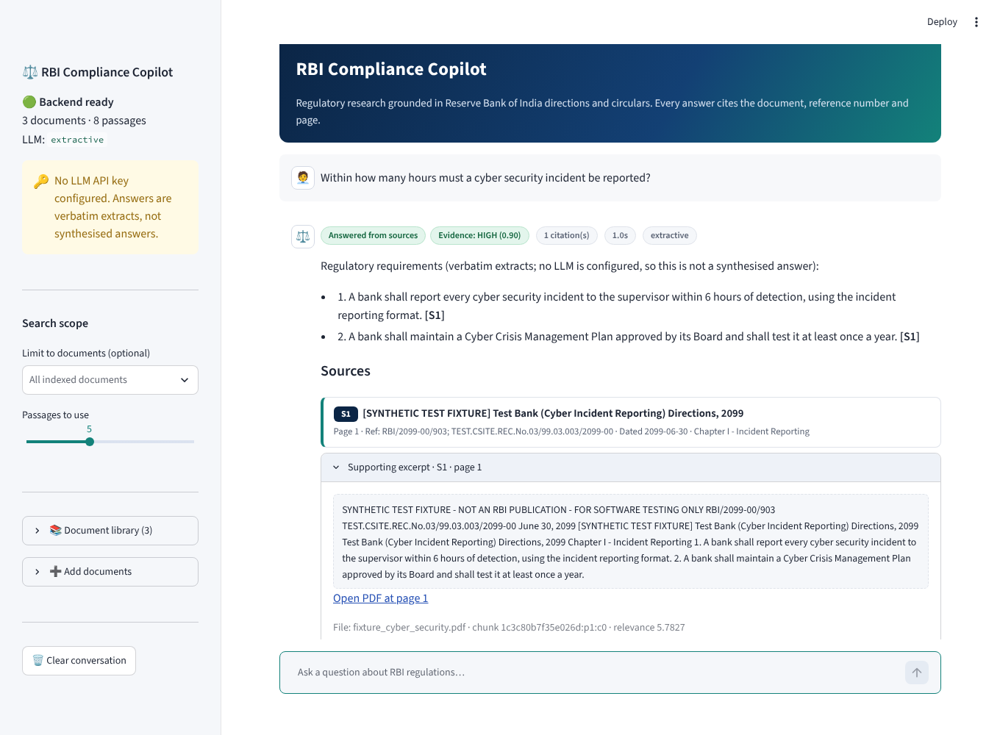
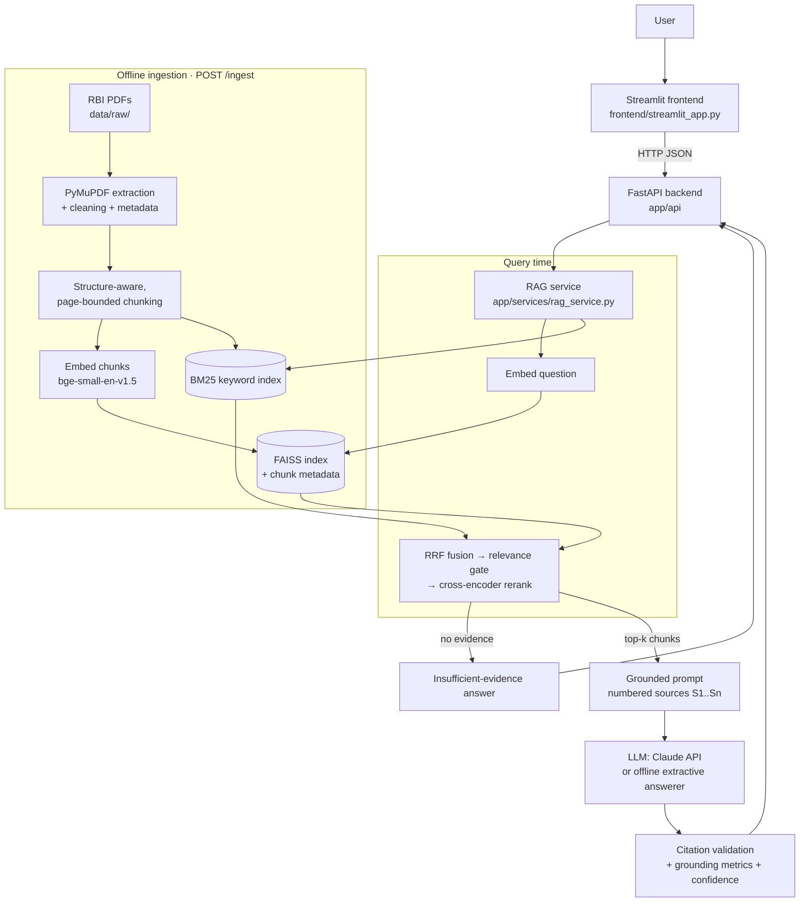

# RBI Compliance Copilot

A retrieval-augmented generation (RAG) assistant that answers questions about **Reserve Bank of India (RBI)** directions, circulars and notifications. Every answer is grounded in retrieved passages and comes with **verifiable citations**: document title, circular number, page number and the supporting excerpt, with a link that opens the original PDF at that page. When the indexed documents do not support an answer, it says so instead of guessing.



> **Status of the data.** The pipeline was built and tested end to end on **synthetic PDF fixtures** (clearly labelled, not RBI content). The 24 official RBI Directions it is designed for are listed in [`data/sources.json`](data/sources.json). They must be downloaded on your machine (see [Add the RBI documents](#3-add-the-rbi-documents)), because RBI's firewall rejected downloads from the build environment. No result in this README comes from real RBI documents.

---

## Contents

1. [Problem statement](#problem-statement)
2. [Architecture](#architecture)
3. [RAG workflow](#rag-workflow)
4. [Technology stack](#technology-stack)
5. [Folder structure](#folder-structure)
6. [Setup & running](#setup--running)
7. [API reference](#api-reference)
8. [Testing & evaluation](#testing--evaluation)
9. [Design decisions](#design-decisions) (chunking strategy and more)
10. [Example questions](#example-questions)
11. [Limitations](#limitations)
12. [Future improvements](#future-improvements)

---

## Problem statement

Compliance teams in Indian banks must track hundreds of RBI directions, each running to dozens of pages and amended frequently. Answering "what exactly does the RBI require here?" means finding the right document, the right paragraph and the exact wording. A general-purpose chatbot is unsuitable for this: it may invent circular numbers, paraphrase thresholds incorrectly or cite superseded rules. The copilot therefore:

* answers **only** from documents in its index,
* shows **where** each statement comes from (document, reference number, page, excerpt),
* separates **regulatory requirements** from **interpretation**, and
* **refuses** when the evidence is insufficient.

## Architecture



The frontend talks to the backend **only over HTTP**, so either can be replaced or scaled on its own. Business logic lives in `app/services`; the API layer only validates input, maps errors to status codes and serialises results.

## RAG workflow

| Step | Where | What happens |
|---|---|---|
| 1. Extract | `app/ingestion/pdf_loader.py` | PyMuPDF reads each page. Corrupted, encrypted, empty and image-only PDFs are rejected with a reason. Blank pages are recorded. |
| 2. Clean | `app/ingestion/text_cleaning.py` | Unicode normalisation; wrapped lines re-joined into paragraphs; words hyphenated across lines repaired; running headers/footers (lines repeated on ≥60% of pages) and bare page numbers removed. Clause boundaries (`1.`, `2.1`, `(a)`, `(iv)`, `Chapter III`) are kept. |
| 3. Metadata | `app/ingestion/metadata.py` | Circular reference (`RBI/2025-26/123`, `DOR.CRE.REC.No.45/21.04.048/2025-26`), date and title are read from the first pages with regexes. Values are only ever *found* in the text; if absent they stay empty. The download manifest supplies the official title and source URL. |
| 4. Dedupe | `app/services/ingestion_service.py` | SHA-256 of file bytes (exact duplicates) plus a hash of the normalised text (same content, different file). |
| 5. Chunk | `app/ingestion/chunker.py` | See [chunking strategy](#chunking-strategy). Every chunk carries doc ID, title, filename, page, circular number, date, section and source URL. |
| 6. Embed | `app/embeddings/embedder.py` | `BAAI/bge-small-en-v1.5` (384-dim). Vectors are L2-normalised, so inner product equals cosine. Queries get BGE's retrieval instruction prefix. |
| 7. Index | `app/retrieval/vector_store.py` | `faiss.IndexIDMap2(IndexFlatIP)`, saved with `chunks.jsonl`, `documents.json` and `store_meta.json`. |
| 8. Retrieve | `app/retrieval/retriever.py` | FAISS top-30 + BM25 top-30 → Reciprocal Rank Fusion → **relevance gate** (cosine ≥ 0.45) → **cross-encoder rerank** (keep logit ≥ −6) → top-k. |
| 9. Generate | `app/generation/` | Numbered sources `[S1]..[Sn]` with metadata headers go to Claude with strict grounding rules. Without an API key, an offline extractive answerer quotes the best source sentences verbatim. |
| 10. Cite & score | `app/generation/citations.py`, `rag_service.py` | `[S#]` markers are mapped back to retrieved chunks. Invented markers are stripped and reported. Citation metadata comes from the chunk, never from LLM text. Grounding metrics and a confidence indicator are computed. Each query is logged to `logs/queries.jsonl`. |

## Technology stack

| Concern | Choice | Why |
|---|---|---|
| Language | Python 3.12 | |
| API | FastAPI + Pydantic v2 | Typed validation, automatic Swagger docs |
| UI | Streamlit | Fast to build a polished, data-heavy UI in pure Python |
| PDF | PyMuPDF | Fast, accurate text layer extraction with page numbers |
| Embeddings | Sentence-Transformers, `BAAI/bge-small-en-v1.5` | Strong retrieval quality for its size; 384 dims; runs on CPU |
| Vector DB | FAISS (`IndexFlatIP` in `IndexIDMap2`) | Exact search, local files, supports deleting a document's vectors |
| Keyword search | `rank_bm25` | Catches exact tokens such as clause numbers, acronyms and figures |
| Reranker | `cross-encoder/ms-marco-MiniLM-L-6-v2` | Reads question and passage together; much more precise than embeddings alone |
| LLM | Claude via the official `anthropic` SDK (`claude-opus-5-5` by default, configurable) | Reliable instruction-following for strict citation rules. Cost is controlled with `LLM_EFFORT` and `LLM_MODEL` (e.g. `claude-haiku-5-5` for the lowest cost). |
| Tests | Pytest, FastAPI `TestClient` | LLM calls are mocked |
| Config / logging | `pydantic-settings`, JSON-lines logging | |

## Folder structure

```
RBI-Compliance-Copilot/
├── main.py                      # starts the FastAPI app (uvicorn)
├── app/
│   ├── api/                     # FastAPI app factory + routes
│   ├── core/                    # settings, logging, exceptions
│   ├── ingestion/               # pdf_loader, text_cleaning, metadata, chunker
│   ├── embeddings/              # sentence-transformers wrapper
│   ├── retrieval/               # vector_store (FAISS), keyword_search (BM25), reranker, retriever
│   ├── generation/              # prompts, LLM providers, citations & grounding
│   ├── services/                # ingestion_service, rag_service, container (wiring)
│   ├── evaluation/              # retrieval / grounding evaluation
│   ├── schemas/                 # Pydantic domain + API models
│   └── utils/fixtures.py        # synthetic test PDFs (NOT RBI content)
├── frontend/streamlit_app.py
├── scripts/
│   ├── download_rbi_documents.py  # fetches the 24 PDFs in data/sources.json
│   ├── ingest.py                  # build/update the index
│   ├── ask.py                     # ask from the command line
│   ├── evaluate.py                # run an evaluation set
│   └── generate_fixtures.py       # write synthetic test PDFs
├── data/
│   ├── sources.json             # curated list of 24 official RBI Directions (URLs)
│   ├── raw/                     # put RBI PDFs here (git-ignored)
│   ├── processed/               # extracted text per document (generated)
│   └── eval/                    # evaluation question sets
├── vector_store/                # FAISS index + metadata (generated)
├── tests/                       # pytest suite
├── .env.example  .gitignore  requirements.txt  pytest.ini
```

## Setup & running

### 1. Install

```bash
python3.12 -m venv .venv
```

```bash
source .venv/bin/activate        # Windows: .venv\Scripts\activate
```

```bash
pip install torch --index-url https://download.pytorch.org/whl/cpu
```

```bash
pip install -r requirements.txt
```

The embedding model (~130 MB) and reranker (~90 MB) download from Hugging Face on first use.

### 2. Configure

```bash
cp .env.example .env
```

Set `ANTHROPIC_API_KEY` in `.env` to enable LLM answers. **Without a key the app still runs**: it uses the offline *extractive* answerer, which returns verbatim, cited source sentences. `/health` and the UI both show which mode is active.

### 3. Add the RBI documents

```bash
python scripts/download_rbi_documents.py
```

This fetches the 24 Directions listed in `data/sources.json` (KYC, Fraud Risk Management, Internal Ombudsman, Outsourcing, Credit Cards, Cyber Security, IRACP, PSL, KCC and others) from `rbidocs.rbi.org.in` into `data/raw/`. If RBI's site rejects the script, open the URLs from `data/sources.json` in your browser, save the PDFs into `data/raw/`, and continue. Any other RBI PDFs work too. See [`data/raw/README.md`](data/raw/README.md).

### 4. Build the index

```bash
python scripts/ingest.py
```

Re-running only processes new or changed files. Add `--rebuild` to start from scratch, which is required after changing the chunking settings or the embedding model. The app also detects such a mismatch on startup and rebuilds automatically.

### 5. Start the backend

```bash
python main.py
```

Swagger UI: <http://127.0.0.1:8000/docs>

### 6. Start the frontend (second terminal)

```bash
streamlit run frontend/streamlit_app.py
```

UI: <http://localhost:8501>

### Run in VS Code (one click)

The repo ships `.vscode/` launch and task configurations.

1. Open the project folder in VS Code and install the recommended Python extension when prompted.
2. **Terminal → Run Task… → "1. Setup: create venv + install dependencies"**, then select the `.venv` interpreter (**Python: Select Interpreter**).
3. Put `ANTHROPIC_API_KEY` in `.env` (optional; without it answers are verbatim extracts).
4. **Run Task → "2. Download the 24 RBI PDFs"** (or copy PDFs into `data/raw/`), then **"3. Ingest PDFs (build index)"**.
5. **Run and Debug (Ctrl+Shift+D) → "▶ Run RBI Compliance Copilot (Backend + Frontend)" → F5.** This starts FastAPI on :8000 and Streamlit on :8501 with breakpoints enabled. Stopping one stops both.
6. Tests: **Run Task → "Run tests"**, or the Testing panel (pytest is pre-configured).

### Try it without RBI documents (synthetic fixtures)

```bash
python scripts/generate_fixtures.py --out data/fixtures
```

```bash
RAW_DATA_DIR=data/fixtures VECTOR_STORE_DIR=vector_store_fixtures PROCESSED_DATA_DIR=data/processed_fixtures python scripts/ingest.py
```

```bash
RAW_DATA_DIR=data/fixtures VECTOR_STORE_DIR=vector_store_fixtures PROCESSED_DATA_DIR=data/processed_fixtures python main.py
```

The fixtures are separate from `data/raw/` and the real index, so they never mix with RBI documents.

## API reference

| Method & path | Purpose |
|---|---|
| `GET /health` | Status, index size, embedding model, LLM provider/model, whether an API key is configured |
| `GET /documents` | Indexed documents with title, circular number, date, pages, chunk count, source URL |
| `GET /documents/{doc_id}/pdf` | Original PDF (open `…/pdf#page=N` to verify a citation) |
| `POST /documents/upload` | Upload a PDF into `data/raw/` (multipart, `.pdf` only, ≤ 50 MB, PDF signature checked, filename sanitised) |
| `POST /query` | Ask a question → grounded answer + citations |
| `POST /ingest` | Incrementally index new/changed/deleted PDFs in `data/raw/` (`{"force": true}` rebuilds) |
| `POST /reindex` | Discard the index and rebuild it from `data/raw/` |

**`POST /query` request**

```json
{
  "question": "Within what time must a bank report a fraud?",
  "top_k": 5,
  "doc_ids": ["optional", "document", "filter"],
  "history": [{"role": "user", "content": "…"}, {"role": "assistant", "content": "…"}]
}
```

Validation: `question` 3–1000 non-blank characters; `top_k` 1–20; `doc_ids` must exist; `history` ≤ 20 turns.

**Response (abridged)**

```json
{
  "status": "answered",                 // or "insufficient_evidence"
  "answer": "… [S1] … [S2]",
  "citations": [{
    "source_id": "S1", "title": "…", "circular_number": "RBI/…; DOR.…",
    "publication_date": "2025-11-28", "page_number": 14, "section": "Chapter IV …",
    "excerpt": "…", "source_filename": "…pdf", "source_url": "https://rbidocs.rbi.org.in/…",
    "doc_id": "…", "chunk_id": "…", "relevance_score": 5.1
  }],
  "retrieved": [ /* every passage given to the LLM, same shape */ ],
  "confidence": {"level": "high", "score": 0.89, "reasons": ["…"]},
  "grounding": {"citation_coverage": 1.0, "lexical_support": 0.81, "invalid_citation_markers": [], "…": "…"},
  "latency": {"retrieval_ms": 180.2, "generation_ms": 2400.5, "total_ms": 2580.7},
  "provider": "anthropic", "model": "claude-opus-5-5"
}
```

Errors: `422` invalid input, `503` empty index or LLM not configured, `502` LLM API failure, `409` an ingestion job is already running.

## Testing & evaluation

```bash
python -m pytest
```

**Result in the build environment: 109 passed** (≈25 s, CPU). The suite covers:

| Area | Tests |
|---|---|
| PDF extraction | page numbering, text on the right page, metadata, corrupted / empty / missing / image-only PDFs, blank pages, cleaning (de-hyphenation, headers, page numbers) |
| Metadata | RBI and department reference formats, date formats, invalid dates, no guessing |
| Chunking | page-bounded chunks, size limit, no lost sentences, whole-sentence overlap, metadata on every chunk, paragraphs kept together, section carry-over, abbreviation-aware sentence splitting |
| Embeddings | dimension consistency, L2 normalisation, semantic ordering, determinism |
| FAISS store | exact-match search, save/load round trip, document removal, incremental add, filters, corrupted index, metadata/vector mismatch, model/config change detection |
| Retrieval | correct document **and page** for 7 questions, irrelevant questions retrieve nothing, scores and ordering, top-k, document filter, BM25, RRF |
| Ingestion | incremental runs, persistence across restart, modified/deleted files, duplicates, corrupted files, forced rebuild, automatic rebuild of a corrupted index |
| Citations | marker parsing, invented markers stripped, metadata from chunks, excerpt selection, grounding metrics |
| Generation | prompt content, Claude request shape (mocked client), refusal/empty/auth/network errors, extractive answers quote only source text, insufficient-evidence handling, follow-up questions, query log |
| API | every endpoint, validation errors, 503/502 mapping, upload sanitisation, PDF serving, OpenAPI |
| Evaluation | quality bar on the fixture gold set |

The real embedding and reranker models are used in tests. **The Claude API is always mocked**: no API key was available, so live LLM answers have not been tested.

**Retrieval evaluation**

```bash
python scripts/evaluate.py data/eval/fixture_questions.jsonl
```

On the synthetic fixtures (8 in-scope + 3 out-of-scope questions): hit@5 = 1.0, page-hit@5 = 1.0, MRR = 1.0, refusal accuracy = 1.0, false refusals = 0, citation coverage = 1.0. This set is tiny and was used to calibrate the thresholds, so these numbers show the pipeline works, **not** how good it is on real documents.

After adding the RBI PDFs, run the real set (16 in-scope + 2 out-of-scope questions, document-level labels):

```bash
python scripts/evaluate.py data/eval/rbi_questions.jsonl
```

If you see false refusals, lower `RERANK_THRESHOLD` or `SIMILARITY_THRESHOLD`. If out-of-scope questions get answered, raise them.

## Design decisions

### Chunking strategy

* **Page-bounded.** A chunk never crosses a page boundary, so each chunk has exactly one page number, and every citation points to a page a reader can open. A provision that runs across two pages becomes two chunks; the sentence overlap and the carried-over section heading keep both retrievable.
* **Structure-aware packing.** Cleaning turns each page into paragraphs whose boundaries follow the regulation's own numbering (`3.1`, `(a)`, `(iv)`, `Chapter`). Whole paragraphs are packed up to `CHUNK_SIZE` (default 1,200 characters, roughly 250–300 tokens), so a clause and its sub-clauses usually stay together.
* **Sentence fallback.** Only a paragraph longer than the limit is split, at sentence boundaries. The splitter knows `No.`, `Rs.`, `i.e.`, `viz.` and clause numbers. An over-long sentence is split on word boundaries as a last resort.
* **Sentence-level overlap.** Each chunk starts with the trailing *whole* sentences (≤ `CHUNK_OVERLAP`, default 200 characters) of the previous one, so context carries across chunks without half sentences.
* **Section context.** The nearest heading ("Chapter IV – Reporting") is stored on the chunk and prepended, with the document title, to the text that is embedded. This helps retrieval for chunks whose own text never names the topic.

### Retrieval: why hybrid + gate + rerank

* **Semantic search** handles paraphrase ("how fast must complaints be resolved" ↔ "shall resolve within 30 days").
* **BM25** handles exact tokens that embeddings blur: clause numbers, acronyms (CRR, SMA-2, KFS), amounts.
* **Reciprocal Rank Fusion** merges the two rankings without having to calibrate their very different score scales.
* **Relevance gate.** Every fused candidate's exact cosine similarity is recomputed, and candidates below `SIMILARITY_THRESHOLD` are dropped. This is a recall-oriented filter.
* **Cross-encoder rerank** is the precision filter. On the fixtures, relevant passages scored ≥ −3.6 and irrelevant ones ≤ −10.7, hence the threshold of −6. If nothing survives, the LLM is **never called** and the user gets an "insufficient evidence" answer.

### Grounding and hallucination controls

1. The LLM sees only the numbered sources and a system prompt that forbids outside knowledge, invented references and invented figures. It requires `[S#]` citations and a separate "Interpretation" section, and defines an exact `INSUFFICIENT_EVIDENCE` reply.
2. Citations are rebuilt from **chunk metadata**. The LLM never supplies a title, circular number or page number, so these cannot be invented.
3. Markers that do not match a retrieved source are removed from the answer, reported in `grounding.invalid_citation_markers`, and lower the confidence score.
4. Grounding metrics: **citation coverage** (share of answer sentences with a citation) and **lexical support** (share of answer content words found in the cited passages).
5. The **confidence indicator** combines best rerank score (50%), number of cited passages (20%) and citation coverage (30%). It is a heuristic evidence indicator, **not** a calibrated probability.
6. Follow-up questions such as "what about NBFCs?" are expanded with the previous question **only if** the question alone retrieves nothing *and* it reads like a follow-up. An unrelated new question is never answered from the previous topic's documents (covered by a test).

### Incremental indexing

Documents are keyed by the SHA-256 of their bytes. Unchanged files are skipped, so embeddings are never recomputed for them. A changed file's old vectors are removed (`IndexIDMap2.remove_ids`) and new ones added, and a deleted file is removed from the index. `store_meta.json` records the embedding model, dimension and chunking settings. A mismatch on startup, a corrupted file, or a vector/metadata count mismatch triggers an automatic rebuild. All files are written atomically (temp file + rename).

### LLM choice and cost

`claude-opus-5-5` is the default for the strongest instruction-following on strict citation rules. `LLM_EFFORT` (default `medium`) trades depth for cost and latency, and `LLM_MODEL=claude-haiku-5-5` is the cheapest option. Requests enable the API's server-side refusal fallback (`LLM_ENABLE_REFUSAL_FALLBACK`). The provider interface (`app/generation/llm.py`) is small, so adding another provider means adding one class.

## Example questions

These are the questions the system is designed for once the 24 RBI Directions are indexed. Answers depend on the documents and are not reproduced here.

* What are the requirements for periodic updation of KYC for high-risk customers?
* Within what time must a bank report a fraud, and to whom?
* What is the role and tenure of the Internal Ombudsman?
* Which activities must a bank not outsource?
* Can a bank issue a credit card without the customer's explicit consent?
* How is an account classified as a non-performing asset?
* What are the priority sector lending targets for domestic commercial banks?

Verified on the synthetic fixtures (extractive mode, no LLM):

| Question | Result |
|---|---|
| Within how many hours must a cyber security incident be reported? | Answered; cites the cyber fixture, **page 1**, "within 6 hours of detection" |
| What must the Key Fact Statement contain? | Answered; cites the digital-lending fixture, **page 2** |
| What about the cooling-off period? *(follow-up after a digital-lending question)* | Answered from the digital-lending fixture |
| What is the best recipe for chocolate cake? | `insufficient_evidence`, no citations, LLM not called |

## Limitations

* **Not tested on the real RBI corpus yet.** Thresholds were calibrated on 3 small synthetic documents and must be re-checked with `scripts/evaluate.py` on the real PDFs.
* **Live LLM path not exercised.** No API key was available, so Claude calls are covered only by mocked tests.
* **No OCR.** Scanned/image-only PDFs are skipped with a reason.
* **Tables.** PyMuPDF extracts table text in reading order; complex multi-column tables can lose their structure.
* **Metadata heuristics.** Circular numbers and dates are regex-based. Unusual formats are left empty rather than guessed. The first date found is used, which for "Updated as on" documents may be the update date.
* **Amendments / supersession** are not modelled. If both old and new versions are indexed, both can be retrieved; check the dates shown in citations.
* **Confidence** is a heuristic, not a calibrated probability.
* **Single-process state.** The index lives in the API process's memory; run one API worker, or move to a shared vector database for horizontal scaling.
* Research aid only, not legal advice.

## Future improvements

* Run and extend the real evaluation set with page-level labels; tune thresholds per corpus.
* LLM-as-judge faithfulness checks per sentence (entailment against the cited excerpt).
* Table-aware extraction (e.g. PyMuPDF `find_tables`) and OCR for scanned circulars.
* Track amendments and supersession; filter by date or "currently in force".
* Streaming responses in the UI; prompt caching of the system prompt.
* Authentication and per-user rate limiting before any shared deployment.
